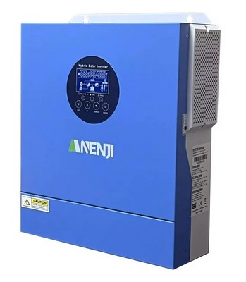

# Anenji–Daly ESP Gateway

[](https://esphome.io/)
[](https://github.com/alidonet/ESPHome-Anenji-Daly/releases/latest)
<!-- [](https://github.com/alidonet/ESPHome-Anenji-Daly/releases) -->

[Русский](README.ru.md)

<p align="center"></p>

This is a Home Assistant / ESPHome project for monitoring the inverter (tested on Anenji 4.2kW) via RS485 port and Daly BMS via BT protocol, as single ESP32 controller.

## Install and configure

1. Download the firmware from [GitHub Releases](https://github.com/alidonet/ESPHome-Anenji-Daly/releases).
   The firmware targets the classic ESP32 (`esp32dev`, chip revision 3.1 or newer).
   Use the `.factory.bin` image for the first USB flash with [ESPHome Web](https://web.esphome.io/).
2. Configure Wi-Fi over USB with Improv Serial, or connect to the **Anenji Daly Setup**
   access point and enter your Wi-Fi credentials in its captive portal.
3. Open the ESP32's address in a browser. In **Daly setup**, click **Find Daly**.
   Find your Daly by name, MAC address, or signal strength in the list
   and choose its number under **Daly device**.
4. Wait for **Daly setup status** to confirm the saved device. The ESP32 stores the choice
   after receiving telemetry and reconnects on startup. When replacing a BMS, a failed
   connection attempt keeps the previous choice.

Defaults are a 30-second Daly poll interval,
a 20-second inverter poll interval, and an 80-register Daly status request. If your
BMS does not respond to the extended request, choose **62 registers** in **Daly
telemetry mode** and retry.

Use **Daly poll interval** and **Inverter poll interval** in the web interface
under **Polling**, or in the Gateway settings in Home Assistant. Both offer
5, 10, 15, 20, 30, 45, 60, 90, and 120 seconds. Each selection applies without
a restart and is saved across restarts.


Required:
  - ESP32
  - RS485 to TTL converter (good to have a board with TX/RX leds);
  - RJ45 half-cable or connector


This is the simple schematics:
```
┌───────────┐              ┌────────────────┐           ┌────────────────────┐
│           │              │             GND│<--------->│GND           ESP32 │
│       1 B-│<-----B- ---->│B-   RS485   RXD│<--------->│RX2 GPIO17          │
│ RJ45  2 A+│<---- A+ ---->│A+   to TTL  TXD│<--------->│TX2 GPIO16          │
│       8   │<--- GND ---->│GND  module  VCC│<--------->│3.3V             VCC│<--5V
│           │              │                │           │                 GND│<--GND
└───────────┘              └────────────────┘           └────────────────────┘
```

## Home Assistant dashboards

The ESPHome integration exposes three devices: **Anenji**, **Daly**, and
**Gateway**. The ESP32 uses the hostname `anenji-daly.local`. Assign each
board a unique ESPHome node name if you install more than one on the same
network. The sample dashboards use the default entity IDs,
such as `sensor.anenji_grid_power` and `sensor.daly_soc`. Advanced settings and
service readings marked disabled by default can be enabled from the entity registry.

The [inverter view](Hass/inverter.yaml) uses [Sunsynk Power Flow Card](https://github.com/slipx06/sunsynk-power-flow-card),
[Power Flow Card Plus](https://github.com/flixlix/power-flow-card-plus), and
[Home Flow Card](https://github.com/flixlix/home-flow-card). The
[Daly view](Hass/bms.yaml) uses [JK BMS Card](https://github.com/Pho3niX90/jk-bms-card).

## License and credits

This project is licensed under the [Apache License, Version 2.0](LICENSE).
The ESPHome inverter configuration is adapted from [syssi/esphome-smg-ii](https://github.com/syssi/esphome-smg-ii),
and Daly support uses [syssi/esphome-daly-bms](https://github.com/syssi/esphome-daly-bms).
Both upstream projects are distributed under Apache-2.0.

## Trademarks

Anenji, DALY, ESPHome, Home Assistant, Bluetooth, and other names and marks
belong to their respective owners. They are used to identify products,
technologies, and compatibility.

This project provides unofficial ESP32 firmware for use with Anenji inverters
and DALY BMS units. It is developed independently of the manufacturers.
