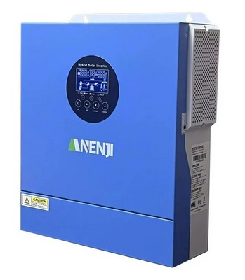

# Шлюз Anenji–Daly на ESP32

[](https://esphome.io/)
[](https://github.com/alidonet/ESPHome-Anenji-Daly/releases/latest)
<!-- [](https://github.com/alidonet/ESPHome-Anenji-Daly/releases) -->

[English](README.md)

<p align="center"></p>

Проект на базе ESP32, где собираются данные инвертора (проверено на версии Anenji 4,2 кВт) по RS485 и батареи Daly BMS по Bluetooth LE. Прошивка использует ESPHome.

Работу прошивки с инвертором проверяли только на Anenji 4,2 кВт. Возможна совместимость с Aninerel ANL-4200T-24L-W / ANL-4200T-24L-W-PRO, EASUN/iSolar SMG II, SMG III 6,2 кВт 48 В, PowMr POW-HVM5.5K-48V / POW-HVM5.5K-48V-P, Qoltec 53963, а также с Anenji ANJ-4200W-24V-W-AE, 6200W-WiFi и 6.2KWT.

## Установка и настройка

1. Скачайте прошивку со страницы [релизов GitHub](https://github.com/alidonet/ESPHome-Anenji-Daly/releases). Она предназначена для классического ESP32 (`esp32dev`, ревизия чипа 3.1 или новее). Для первой прошивки по USB используйте образ `.factory.bin` и [ESPHome Web](https://web.esphome.io/).
2. Настройте Wi-Fi через USB с помощью Improv Serial или подключитесь к точке доступа **Anenji Daly Setup** и введите данные своей сети на странице настройки.
3. Откройте адрес ESP32 в браузере. В разделе **Daly setup** нажмите **Find Daly**. Найдите свою BMS в списке по имени, MAC-адресу или уровню сигнала и выберите её номер в **Daly device**.
4. Дождитесь подтверждения в **Daly setup status**. ESP32 сохраняет выбранную BMS после получения телеметрии и подключается к ней при запуске.

По умолчанию Daly опрашивается каждые 30 секунд, инвертор — каждые 20 секунд. Для Daly запрашиваются 80 регистров. Если BMS не отвечает на расширенный запрос, выберите **62 registers** в **Daly telemetry mode** и повторите попытку.

Интервалы **Daly poll interval** и **Inverter poll interval** доступны в разделе **Polling** веб-интерфейса и в настройках устройства Gateway в Home Assistant. Для каждого можно выбрать 5, 10, 15, 20, 30, 45, 60, 90 или 120 секунд. Выбор применяется без перезагрузки и сохраняется после неё.

## Подключение

- ESP32.
- Преобразователь RS485 ↔ TTL. Удобно, если на плате есть индикаторы TX/RX.
- Кабель с разъёмом RJ45 на одном конце или отдельный разъём RJ45.

```
┌───────────┐              ┌────────────────┐           ┌────────────────────┐
│           │              │             GND│<--------->│GND           ESP32 │
│       1 B-│<-----B- ---->│B-   RS485   RXD│<--------->│RX2 GPIO17          │
│ RJ45  2 A+│<---- A+ ---->│A+   to TTL  TXD│<--------->│TX2 GPIO16          │
│       8   │<--- GND ---->│GND  module  VCC│<--------->│3.3V             VCC│<--5V
│           │              │                │           │                 GND│<--GND
└───────────┘              └────────────────┘           └────────────────────┘
```

## Язык

Параметр **Language** доступен в веб-интерфейсе ESP32 и в настройках шлюза в Home Assistant. По умолчанию выбран английский. Выберите **Русский**, чтобы перевести режим, ошибки и предупреждения инвертора, состояние и ошибки Daly, а также сообщения настройки BLE.

Язык сохраняется после перезагрузки и сразу применяется к уже полученным текстовым состояниям. Имена и идентификаторы сущностей сохраняются. Если автоматизация сравнивает текст состояния, учитывайте выбранный язык.

## Панели Home Assistant

Интеграция ESPHome создаёт три устройства: **Anenji**, **Daly** и **Gateway**. Сетевое имя ESP32 — `anenji-daly.local`. Если в одной сети установлено несколько плат, задайте каждой уникальное имя узла ESPHome.

В примерах панелей используются стандартные идентификаторы, например `sensor.anenji_grid_power` и `sensor.daly_soc`. Сервисные показания и расширенные настройки, отключённые по умолчанию, можно включить в реестре сущностей Home Assistant.

Для [вкладки инвертора](Hass/inverter.yaml) нужны [Sunsynk Power Flow Card](https://github.com/slipx06/sunsynk-power-flow-card), [Power Flow Card Plus](https://github.com/flixlix/power-flow-card-plus) и [Home Flow Card](https://github.com/flixlix/home-flow-card). Для [вкладки Daly](Hass/bms.yaml) нужна [JK BMS Card](https://github.com/Pho3niX90/jk-bms-card).

## Лицензия и благодарности

Проект распространяется по [лицензии Apache 2.0](LICENSE). Конфигурация инвертора адаптирована из [syssi/esphome-smg-ii](https://github.com/syssi/esphome-smg-ii), а для Daly используется компонент [syssi/esphome-daly-bms](https://github.com/syssi/esphome-daly-bms).

## Торговые марки

Anenji, DALY, ESPHome, Home Assistant, Bluetooth и другие названия и знаки принадлежат своим правообладателям. Они используются для обозначения продуктов, технологий и совместимости.

Это неофициальная прошивка для ESP32, предназначенная для работы с инверторами Anenji и DALY BMS. Проект разрабатывается независимо от производителей.
